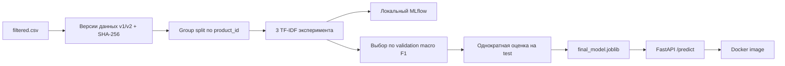

# Классификация тональности отзывов Wildberries

Воспроизводимый ML-проект для классификации русскоязычных отзывов на `negative`, `neutral` и `positive`. Метки получены по рейтингу: 1–2 звезды — отрицательный класс, 3 — нейтральный, 4–5 — положительный. Это приближение тональности по рейтингу, а не ручная разметка эмоций.

## Окружение

- Python 3.12.x; проверенная версия и зависимости указаны в `pyproject.toml` и `poetry.lock`.
- Poetry 2.5.1.
- Данные и итоговый обученный артефакт хранятся локально и исключены из Git.
- `requirements.txt` содержит точные версии inference-зависимостей из lock-файла; пересоздать его можно командой `poetry run python scripts/export_requirements.py`. Для обучения и MLflow устанавливайте полную группу из lock-файла через Poetry.

```bash
poetry env use 3.12
poetry install --sync
cp /path/to/filtered.csv data/raw/filtered.csv
PYTHONPATH=src poetry run python -m wb_sentiment.prepare
PYTHONPATH=src poetry run python -m wb_sentiment.train
```

Команда подготовки создаёт `data/versions/v1.csv`, `v2.csv` и `manifest.json`. Версия v1 удаляет строки с пустым текстом; v2 дополнительно приводит текст к нижнему регистру и удаляет дубликаты пары «текст + рейтинг». Manifest хранит SHA-256 источника и обеих версий. В текущем исходном файле 27 248 отзывов и 7 086 товаров.

## Эксперименты и данные

Сравниваются три модели на одинаковом групповом разбиении 70/10/20 по `product_id`: word TF-IDF + Logistic Regression (`C=1`), word TF-IDF + Logistic Regression (`C=3`), word+character TF-IDF + LinearSVC. Модель выбирается по macro F1 на validation; test используется один раз после выбора. Каждая попытка записывается в локальный MLflow tracking store (`mlruns/`) с параметрами, метриками, SHA данных и Git revision. Итоги доступны в `reports/experiments.csv`, метрики теста — в `reports/test_report.json`, выбранный bundle — в `artifacts/final_model.joblib`.

```bash
poetry run mlflow ui --backend-store-uri sqlite:///./mlflow.db --host 127.0.0.1
```

В браузере откройте `http://127.0.0.1:5000`. Runs хранятся в локальной базе `mlflow.db`, artifacts — в `mlartifacts/`; для преподавателя их нужно перенести в доступное ему хранилище и указать ссылку в `REPORT.md`.

На итоговом запуске лучший run — `dc94e7f4625c45ed93bb953c01e143d1` (validation macro F1 `0.6536`). Итоговый artifact run — `f92bdf85627149dfac8f5f72fd2ec739`; test macro F1 `0.6276`, accuracy `0.8194`, weighted F1 `0.8247`.

## Проверки

```bash
poetry run ruff check src tests scripts
poetry run pytest --cov=wb_sentiment --cov-report=term-missing --cov-fail-under=80
```

## HTTP-сервис

После обучения:

```bash
PYTHONPATH=src poetry run uvicorn wb_sentiment.api:app --host 127.0.0.1 --port 8000
```

- `GET /health` — готовность модели и версия.
- `POST /predict` — предсказание, версия модели и ID конфигурации.
- `GET /docs` — OpenAPI документация.

Пример запроса:

```bash
curl -X POST http://127.0.0.1:8000/predict \
  -H 'Content-Type: application/json' \
  -d '{"text":"Отличное качество, очень нравится!", "pros":"удобно", "cons":""}'
```

Пустое поле `text` отклоняется схемой с HTTP 422; если модель отсутствует, сервис возвращает 503.

## Docker

Сначала обучите модель, затем соберите и запустите контейнер:

```bash
docker build -t wb-sentiment:1.0.0 .
docker run --rm -p 8000:8000 wb-sentiment:1.0.0
bash scripts/docker_smoke.sh wb-sentiment:1.0.0
```

Основа образа закреплена на `python:3.12.12-slim-bookworm`, приложение работает от непривилегированного пользователя. `Dockerfile` копирует только исходный код, фиксированные зависимости и обученный артефакт; данные и локальные конфигурации исключены через `.dockerignore`.

В CI создаётся маленькая учебная модель только для проверки сборки и HTTP-контракта. Она не является итоговой моделью проекта. Production image собирается локально с `artifacts/final_model.joblib`, полученным из лучшего эксперимента.

## Схема



## Структура

```text
src/wb_sentiment/  подготовка данных, обучение, HTTP API
tests/             тесты API и группового разбиения
scripts/           smoke-модель CI и проверка контейнера
data/              исходник и производные версии, локально
artifacts/         выбранная модель, локально
reports/           сводка экспериментов и тестовые метрики, локально
MODEL_CARD.md      назначение, оценка и ограничения модели
DATASET_CARD.md    источник, версии, разбиение и ограничения
REPORT.md          контрольный список материалов сдачи
```

## Сдача

Отчёт находится в `REPORT.md`, сценарий записи видео — в `DEMO_SCRIPT.md`. Модельный артефакт и данные не включены в Git: итоговый `artifacts/final_model.joblib` будет приложен к GitHub Release. После публикации проверьте CI и добавьте ссылки на репозиторий, релиз, pipeline и видео в отчёт.
